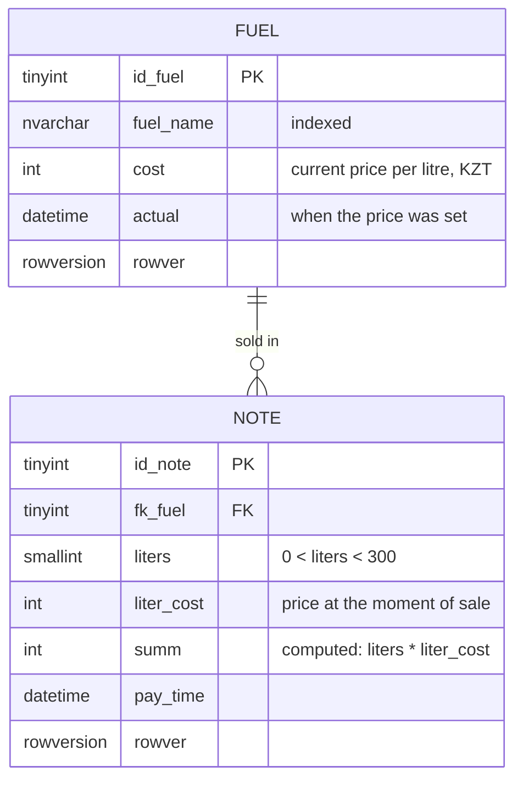

# Fuel Station Sales Database

Coursework for the *Databases* course at the German-Kazakh University (DKU), Almaty, 2022.
The task was to model a fuel station from scratch, from domain analysis to a working
Microsoft SQL Server database and a desktop app on top of it.

This repository contains the database part: schema, stored procedures and demo data.

## Scope

A fuel station can be described from several angles: the shop, the staff and equipment, security.
The coursework focuses on one of them: **the fuel sale**. A customer buys a number of litres of
one fuel grade, pays, and the sale is written to a sales log. The monthly revenue report
is built from that log.

That narrows the model to two entities:

- **Fuel**: the fuel grades on sale and their current price per litre
- **Note**: the sales log, one row per sale

## Data model



Fuel grades in the demo data, with 2022 prices in Kazakhstani tenge (KZT):

| fuel_name | Meaning | Price per litre |
|---|---|---|
| АИ-92 | Petrol, RON 92 | 170 |
| АИ-95 | Petrol, RON 95 | 210 |
| АИ-98 | Petrol, RON 98 | 235 |
| ДТ | Diesel | 280 |
| Газ | LPG | 70 |

## Design decisions

- **The price is copied into every sale.** `Note.liter_cost` stores the price at the moment
  of sale instead of looking it up in `Fuel`. When the price changes later, past sales
  and past revenue stay correct.
- **The total is a persisted computed column.** `summ AS (liters * liter_cost) PERSISTED`
  is calculated by the database, so it can't drift away from its inputs, and it is stored,
  so revenue reports don't recompute it on every read.
- **Constraints in the database, not only in the app.** A `CHECK` limits a single sale to
  under 300 litres and the price to positive values; a foreign key ties every sale to an
  existing fuel grade.
- **`rowversion` on both tables** for optimistic concurrency, so two cashiers editing
  the same row can detect the conflict.
- **Errors are returned, not thrown.** The procedures wrap their statements in
  `TRY...CATCH` and return the error number and message as output parameters to the caller.

## Repository structure

```
sql/
  01_schema.sql      tables, foreign key, index
  02_procedures.sql  pr_Fuel (insert/update/delete a fuel grade), pr_Note (record a sale)
  03_seed_demo.sql   five fuel grades and one test sale
  04_checks.sql      checks for the design decisions above (PASS/FAIL, rolled back at the end)
```

## Running it

Requires Microsoft SQL Server (2019 or later) and `sqlcmd`. With Docker:

```bash
docker run -e "ACCEPT_EULA=Y" -e "MSSQL_SA_PASSWORD=<YourStrong!Passw0rd>" \
  -p 1433:1433 -d mcr.microsoft.com/mssql/server:2022-latest

sqlcmd -S localhost -U sa -P "<YourStrong!Passw0rd>" -C -f 65001 -i sql/01_schema.sql
sqlcmd -S localhost -U sa -P "<YourStrong!Passw0rd>" -C -f 65001 -i sql/02_procedures.sql
sqlcmd -S localhost -U sa -P "<YourStrong!Passw0rd>" -C -f 65001 -i sql/03_seed_demo.sql
sqlcmd -S localhost -U sa -P "<YourStrong!Passw0rd>" -C -f 65001 -i sql/04_checks.sql
```

`04_checks.sql` is not part of the 2022 coursework; it was added later to verify the
design decisions and should print four `PASS` lines.

Or open the three files in SQL Server Management Studio and run them in order.

`-f 65001` makes `sqlcmd` read the files as UTF-8, which the Cyrillic fuel names need.

## Changes from the 2022 version

- Comments translated from Russian to English.
- `fuel_name` changed from `varchar` to `nvarchar` (and the demo values to `N'...'`
  literals) so the Cyrillic names are stored correctly on any server collation.
- The original script dropped the database at the end of the demo run; that line is removed.
- Each file starts with `SET QUOTED_IDENTIFIER ON` and `SET ANSI_NULLS ON`. SSMS turns
  these on by default, `sqlcmd` doesn't, and SQL Server requires them for a table with a
  persisted computed column (`Note.summ`) and for procedures that write to it.
- The script is split into three files.

Nothing else was changed, including the things below.

## Looking back

What I would do differently today:

- **Key types.** `id_note` is a `tinyint`, so the sales log can hold at most 255 sales.
  It should be `int` (or `bigint`).
- **Price history.** `Fuel` keeps only the current price; an `UPDATE` overwrites the old one.
  Sales are still correct because each one stores its own price, but there is no record of
  *when* prices changed. A separate `FuelPrice (id_fuel, price, valid_from, valid_to)` table
  would keep that.
- **Payment method.** The written report describes cash, card and fuel-card payments and a
  payment-method lookup table, but the table never made it into the script.
- **`SCOPE_IDENTITY()` instead of `@@IDENTITY`**, which can return an id generated by a trigger.
- **Small inconsistencies:** `pr_Fuel` stores the price date in a `date` variable, so the time
  of day is lost in `actual`; `pr_Note` accepts `@choice` and `@num` but only ever inserts;
  `@err_message` is `varchar(100)`, so longer SQL Server error messages get cut off
  (`ERROR_MESSAGE()` returns up to `nvarchar(4000)`).
- **The app should go through the procedures.** In the coursework the desktop app sent its own
  SQL through `pyodbc`, so the procedures were only used for the demo data.

## Not included

The coursework also had a desktop app in Python (Tkinter, pyodbc) for recording sales,
printing a receipt and exporting a monthly revenue report to Excel. It is not in this
repository: it was my first GUI program and its code doesn't show the database work well.
